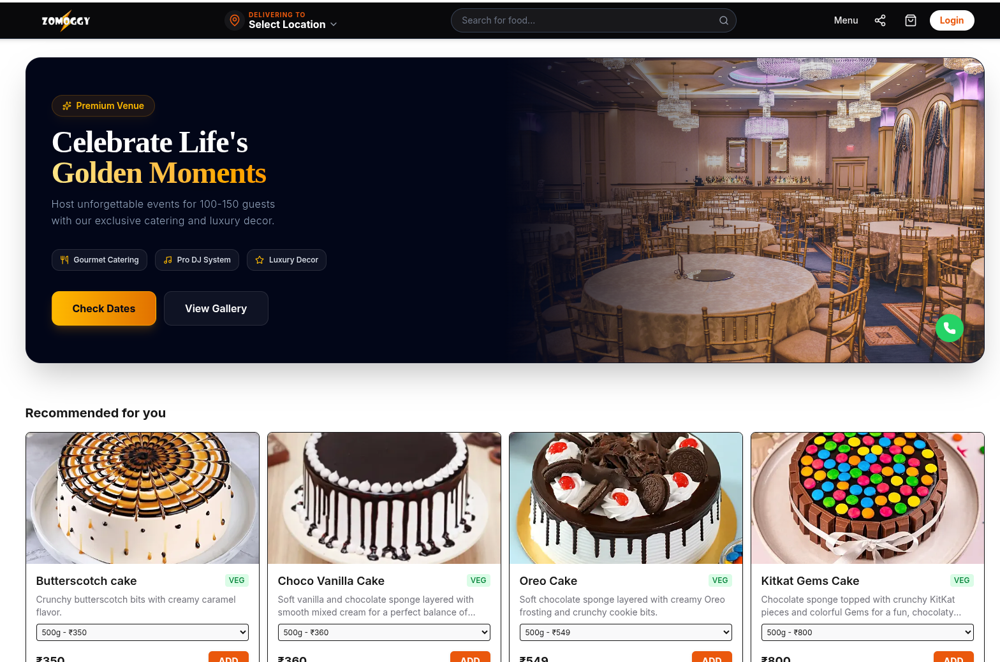
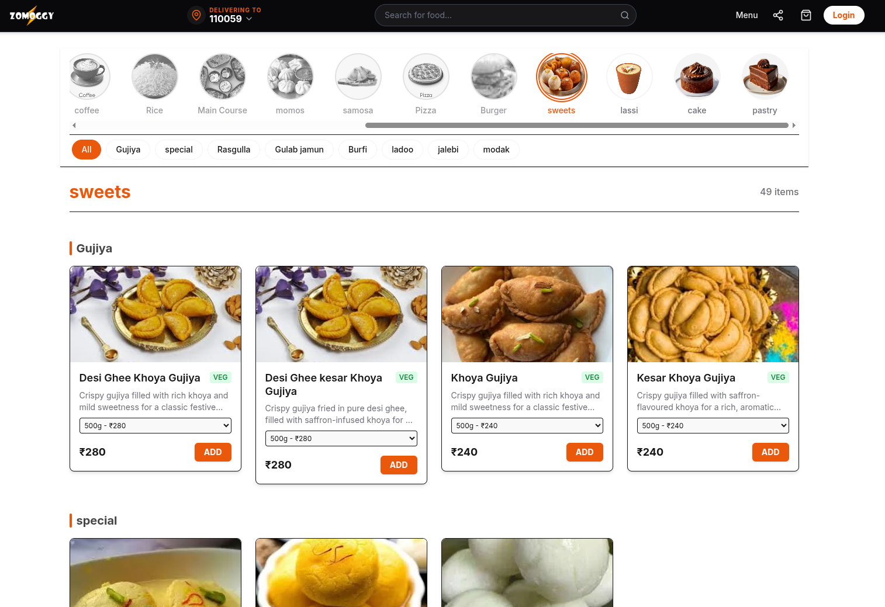
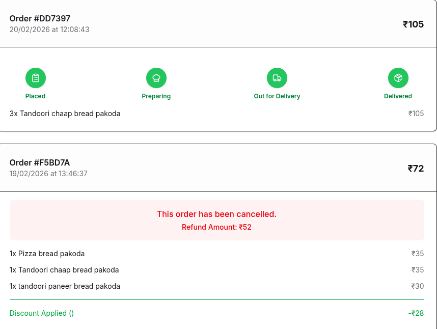
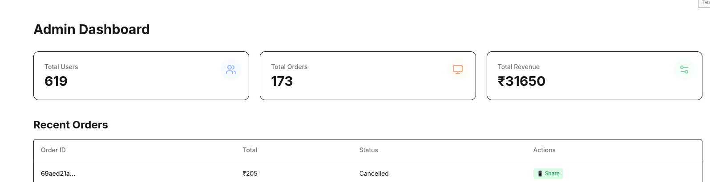
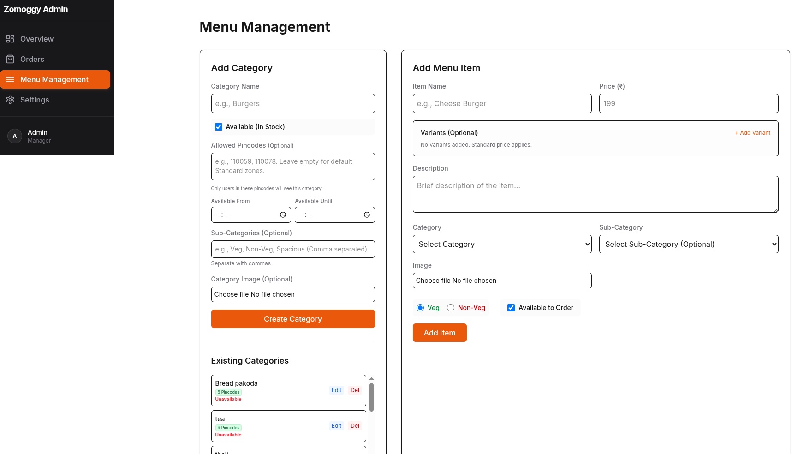
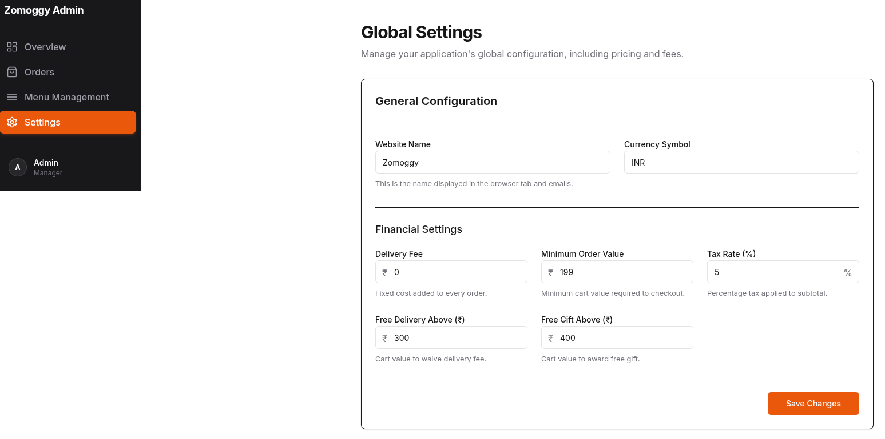

# Zomoggy Franchise Platform

Zomoggy is a full-stack, scalable MERN food ordering and franchise management platform with web and mobile applications.

## 🚀 Repositories / Project Structure

- `client`: Next.js Web Application containing user, franchise, and admin portals. Built with TailwindCSS and Framer Motion.
- `server`: Node.js/Express Backend REST API featuring JWT authentication, role-based access, image edge-delivery (Cloudinary), payment processing, and Firebase integration.
- `zomoggyiya`: Android App native client built to interact with the Zomoggy backend natively.

## 📸 Screenshots

  
  
  
  
  
  

## ⚙️ Features
- **Multi-Role Dashboards:** Separate panels for Admin, Franchise, and Customer.
- **Real-Time Ordering:** Fast order creation and party-hall booking functionalities.
- **Payment Integrations:** Razorpay seamless online checkout processing.
- **Push Notifications:** Web-based push notifications utilizing VAPID keys.

## 🛠️ Tech Stack
- **Frontend**: React, Next.js, TailwindCSS
- **Backend**: Node.js, Express, MongoDB, Mongoose
- **Cloud/Services**: Cloudinary (Image Storage), Firebase (App Services), Razorpay (Payments)

## 🏃‍♂️ Getting Started

### 1. Backend Setup
1. Navigate to the server folder: `cd server`
2. Install dependencies: `npm install`
3. Create a `.env` file based on `server/.env.example`
4. Start the development server: `npm run dev`

### 2. Frontend Setup
1. Navigate to the client folder: `cd client`
2. Install dependencies: `npm install`
3. Create a `.env.local` file based on `client/.env.example`
4. Start the frontend: `npm run dev`

### 3. Android Setup
1. Open the `zomoggyiya` directory in Android Studio.
2. Ensure you add `google-services.json` configuring your valid Firebase App API keys.
3. Sync Gradle and run on your emulator or native device.
